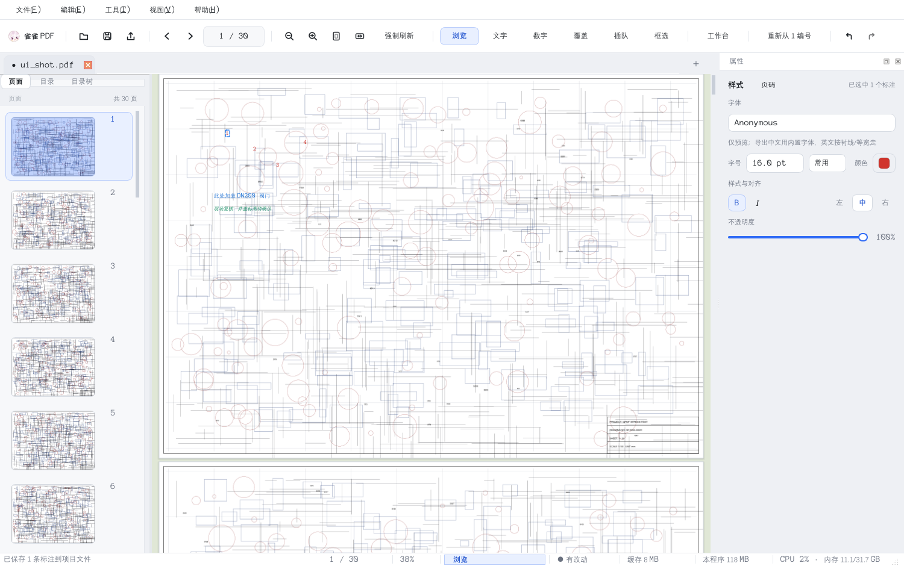

# QPDF — 雀雀 PDF

面向**大型工程图纸**的 Windows 桌面端 PDF 标注工具。

不是 PDF 编辑器，只把"在图纸上标数字、标文字、找管线号"这件事做顺，并且做到上千页的图纸不卡。原始 PDF 全程只读，标注单独存在 `.qpdf` 项目文件里。

- 典型场景：2700+ 页 / 1.3 GB 的 CAD 导出图纸
- 运行环境：Windows 10 / 11 64 位，完全离线，绿色免安装
- 技术栈：Python 3.13 + PySide6 + PyMuPDF + SQLite



## 功能

**看图纸**
- 打开即用，支持拖放；超大 PDF 按视口区域瓦片渲染 + 线程池 + LRU 缓存，翻页不等整页
- 缩略图、跳页、适应窗口 / 适应宽度 / 实际大小、Ctrl+滚轮缩放
- 旋转页（`/Rotate`）坐标正确，导出不跑位
- 工作台（F7）：把跨页的几张图摆到同一块画布上对照着看、对着标，不动 PDF 页序；可分多块、复制、备注、调整叠放次序

**标数字**
- F2 连点出数，自动递增；跨页继续编号；R 随时回到 1
- F3 覆盖：点旧数字挪到新位置，编号不变
- F4 插队：中间补一个，后面的整批后移，一次撤销回滚
- 编号存"槽位"而非文本（组 / 序号 / 坐标），显示值现算

**标文字**
- F5 点击写字，字体 / 字号 / 颜色 / 对齐 / 透明度可调，页面内联编辑
- 拖动、复制粘贴、Ctrl+Z 撤销重做

**管理标注**
- F6 框选批量删除；Ctrl+L 锁定（拖不动、删不掉）、Ctrl+H 隐藏、Ctrl+U 临时全部隐藏看底图
- 所有标注按页组织，属性面板统一调整

**识别与目录**
- 框选区域做文字识别（原生文字层 / OCR），批量扫管线号
- 左侧"管线号"目录树按前缀分组，同一编号跨页合并，可疑结果进"待校对"
- 结果可人工校对，确认后导出为 PDF 书签

**项目与导出**
- `Ctrl+S` 存 `.qpdf`（SQLite），自动保存、操作日志、崩溃恢复、自动备份
- 项目文件默认在 `文档\雀雀PDF\项目\`，文件名带图纸指纹，改版图纸不会互相覆盖
- `Ctrl+E` 导出 PDF：默认写成标准 FreeText 注释（Acrobat / Foxit / WPS 都能改），也可扁平化用于打印归档
- 导出先写临时文件、重开校验页数与注释数，通过才落盘；原始 PDF 一个字节都不动

## 部署

### 方式一：绿色版（推荐给使用者）

绿色版是不依赖 Python / PySide6 / PDF 阅读器的独立目录，解压后双击 `QPDF.exe` 即可。不写注册表，配置落在程序目录 `config\settings.ini`，可从 U 盘或含中文、空格的路径运行。

> `_internal\` 不能删，`QPDF.exe` 必须和它放在一起。

打包（一条命令）：

```powershell
powershell -ExecutionPolicy Bypass -File .\build_exe.ps1
```

产物在 `dist\`：`dist\QPDF\`（绿色版目录）与 `dist\QPDF_绿色版_*.zip`。脚本会自动跑一次自检（真开一份 PDF、真渲染一页），失败即报错。

用一份自己的图纸手动自检：

```powershell
.\dist\QPDF\QPDF.exe --selftest "D:\图纸\某工程.pdf"
```

### 方式二：源码运行（开发）

```powershell
git clone https://github.com/8que/QPDF.git
cd QPDF

python -m venv .venv
.\.venv\Scripts\python.exe -m pip install -r requirements.txt
.\.venv\Scripts\python.exe main.py
```

也可以直接把 PDF 拖进窗口，或：

```powershell
.\.venv\Scripts\python.exe main.py "D:\图纸\某工程.pdf"
```

依赖见 [`requirements.txt`](requirements.txt)。

## 上手三步

1. 打开（或拖入）一份 PDF；
2. 按 `F2` 点一下出一个编号，`F5` 点一下写一段文字；标完 `Ctrl+S` 存项目；
3. 要发给别人就 `Ctrl+E` 导出 PDF，产物在程序目录 `输出\`。

## 快捷键

| 键 | 功能 | 键 | 功能 |
| --- | --- | --- | --- |
| `Ctrl+O` | 打开 PDF | `Ctrl+S` | 保存项目 |
| `Ctrl+E` | 导出 PDF | `Ctrl+W` | 关闭文档 |
| `F2` | 连续数字标注 | `F3` | 覆盖旧数字（编号不变） |
| `F4` | 插队（后续编号后移） | `F5` | 文字标注 |
| `F6` | 框选删除 | `F7` / `F8` | 工作台 / 加入当前页 |
| `Ctrl+Shift+R` | 重新从 1 编号 | `R` | 回到 1 重新计数 |
| `Ctrl+L` | 锁定 / 解锁 | `Ctrl+H` | 隐藏标注 |
| `Ctrl+U` | 全部标注显隐 | `V` | 回到浏览（拖动画布） |
| `Ctrl+Z` / `Ctrl+Y` | 撤销 / 重做 | `Esc` | 退出当前模式 |
| `Ctrl+Shift+O` | 批量识别管线号 | `Ctrl+Shift+E` | 护眼模式 |

完整列表见 [`docs/使用说明.md`](docs/使用说明.md)。

## 项目结构

```
QPDF/
├── main.py                 程序入口
├── core/                   与界面无关的核心逻辑
│   ├── pdf_engine.py       PyMuPDF 封装：开文档、页尺寸、区域渲染
│   ├── render_manager.py   瓦片渲染 + 线程池 + LRU 缓存
│   ├── annotation.py       标注数据模型
│   ├── sequence.py         编号序列（组 / 序号 / 起点 / 步长）
│   ├── project_manager.py  .qpdf 项目文件：自动保存 / 备份 / 日志
│   ├── exporter.py         导出 PDF：FreeText 注释 / 扁平化 / 写后校验
│   ├── workbench.py        工作台数据
│   ├── extractor.py        文字层 / OCR 提取
│   └── history.py          撤销 / 重做
├── database/               SQLite 存储层（建表、迁移、读写）
├── ui/                     界面层（主窗口、页面视图、工作台、面板、主题）
├── qreport/                QReport：只读 .qpdf 的编号统计模块
├── qreport_app/            QReport 独立桌面界面
├── docs/                   使用说明 / 数据结构 / 需求规格 / QReport
└── resources/              图标与版本信息
```

## 设计要点

1. **标注不写回 PDF**：点击只写数据库，屏幕用叠加层绘制，只有导出时才碰 PDF。
2. **编号是槽位不是文本**：存 `(组, 序号, 坐标)`，显示值现算，插队只需一条 SQL。
3. **渲染按区域裁剪**：只渲染视口可见部分，开销与视口面积成正比。
4. **坐标永远用 PDF 页面坐标（pt）**，屏幕像素坐标绝不落库。
5. **插队是一批改动、一条命令**：中途出错就地回滚，不会只改一半。
6. **项目文件和 PDF 分家**：`.qpdf` 只存标注和图纸指纹，1.3 GB 的图纸也不会多占一份。
7. **导出只写临时文件**：校验通过才改名落盘，失败不碰原始 PDF。

## 文档

- [使用说明](docs/使用说明.md)
- [QPDF 数据结构说明](docs/QPDF数据结构说明.md)
- [QReport 说明](docs/QReport.md)
- [需求规格说明书 V1.1](docs/需求规格说明书_V1.1.md) · [增量 V1.0](docs/需求规格说明书_增量V1.0.md)

## 说明

测试脚本、真实图纸与项目数据不随仓库发布。验证请用自己的 PDF 运行 `QPDF.exe --selftest <文件>`。
